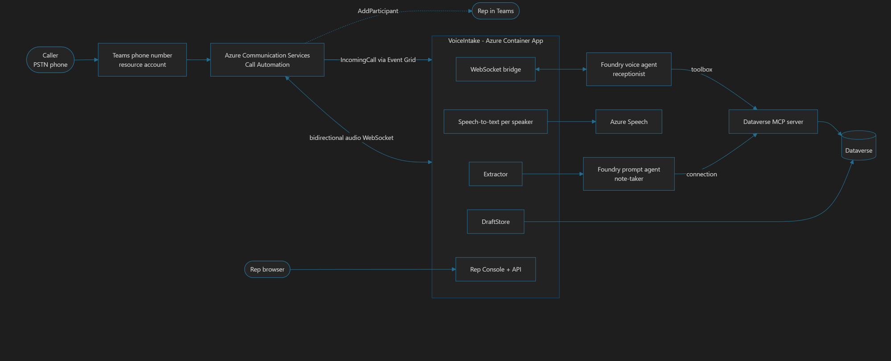

# FloorWorks Live Intake

**An AI receptionist that answers your service line, a note-taker that fills in the ticket while the customer talks,
and a human rep who reviews and submits it.**

A customer dials one number. An AI voice agent answers instantly, finds the equipment in Dataverse, and brings in a human
rep on request, all on the same call. Behind the scenes a second agent keeps a **draft service request** up to date. The
rep sees it fill in live, fixes anything, and clicks **Submit**. Only then is a real service ticket created.

```
Caller ─► AI receptionist ─(on request)─► Human rep joins the same call
              │
              └─ note-taker ─► Draft in Dataverse ─► Rep Console ─ Submit ─► Service Ticket
```



> **Disclaimer.** This is a sample, customized implementation of the
> [Azure-Samples/call-center-voice-agent-accelerator](https://github.com/Azure-Samples/call-center-voice-agent-accelerator).
> It also uses the [Dataverse MCP server in Microsoft Foundry](https://techcommunity.microsoft.com/blog/azure-ai-foundry-blog/consume-dataverse-mcp-server-in-microsoft-foundry-bringing-business-data-to-ai-a/4548218)
> to bring business data to the agents. It is provided as-is for demonstration, not as production-ready software.

### Key references

- [Call center voice agent accelerator](https://github.com/Azure-Samples/call-center-voice-agent-accelerator): the base this project customizes.
- [Consume the Dataverse MCP server in Microsoft Foundry](https://techcommunity.microsoft.com/blog/azure-ai-foundry-blog/consume-dataverse-mcp-server-in-microsoft-foundry-bringing-business-data-to-ai-a/4548218)
- [Voice agent telephony channels: configure transfer to a person](https://learn.microsoft.com/en-us/azure/foundry/agents/how-to/voice-agent-telephony-channels?tabs=portal#configure-transfer-to-a-person)

## Why it is different

- **Draft, then human submit.** Agents never create tickets. Trust is built into the design.
- **One call, one app.** No bot VMs; the app owns the call end to end.
- **Native Microsoft Foundry agents** with business data from the **Dataverse MCP server**.
- **Rep edits always win.** Corrections are never overwritten by the AI.
- **Nothing is lost.** The draft and transcript persist even if the call drops.

## Documentation

| Start with | |
|---|---|
| [Solution overview](docs/01-overview.md) | What it does and why |
| [Architecture](docs/02-architecture.md) | Diagrams and call lifecycle |
| [Deployment guide](docs/03-deployment.md) | Stand it up in your tenant |
| [Demo guide](docs/11-demo-guide.md) | Run a clean demo |

Everything else is indexed in **[docs/README.md](docs/README.md)**: configuration, data model, AI agents, rep console,
operations and troubleshooting, security, roadmap and glossary.

## Repository layout

| Path | Purpose |
|---|---|
| [`src/VoiceIntake`](src/README.md) | **The product**: call handling, speech, agents, draft store, Rep Console |
| [`dataverse/`](dataverse/README.md) | Schema and seed script for the manufacturing data |
| [`foundry/`](foundry/README.md) | Agent instructions, publishing and Foundry-to-Dataverse wiring |
| [`infra/`](infra/README.md) | Deployment and Azure telephony setup |
| [`teams/`](teams/README.md) | Teams number and rep enablement |
| [`docs/`](docs/README.md) | All documentation |

## Quick start

```powershell
# 1. Data
dataverse/provision-dataverse.ps1 -OrgUrl https://<org>.crm.dynamics.com
# 2. Foundry <-> Dataverse, agents, toolbox     -> foundry/README.md
# 3. Telephony (bot, Event Grid, Teams number)  -> infra/README.md, teams/README.md
# 4. App: azd up (see docs/03-deployment.md#azd-quick-start)
```

Then open `https://<app>/rep?k=<rep-key>` and call your number.

## Status

Proof of concept, running in one tenant. Core flow works end to end: inbound call, AI receptionist, Dataverse lookups,
rep transfer, live draft and form, rep Submit. Not yet production-ready: see the
[security checklist](docs/09-security.md) and the [roadmap](docs/10-roadmap.md) (least-privilege roles, Entra sign-in for
reps, recording disclosure, durable state, infrastructure as code).

## Prerequisites at a glance

Azure subscription with Container Apps, ACR, ACS, Speech and a Foundry project · Dataverse environment · Teams with a
phone number, a resource-account license and Enterprise Voice reps · PowerShell 7, Azure CLI, .NET 8 SDK.
Details in the [deployment guide](docs/03-deployment.md#1--prerequisites).

## License and sharing

No license has been chosen. Do not publish or share this repository until you decide on one and have removed any
environment-specific values (see [configuration](docs/04-configuration.md#reference-deployment-values)).
