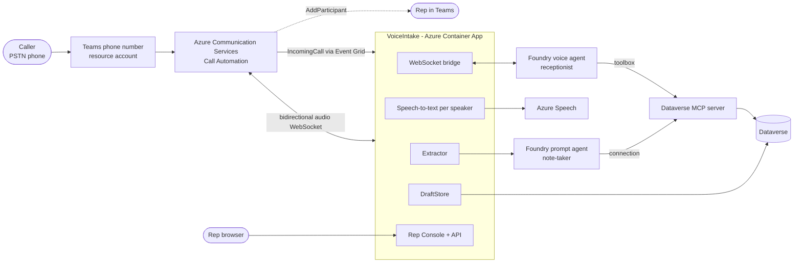
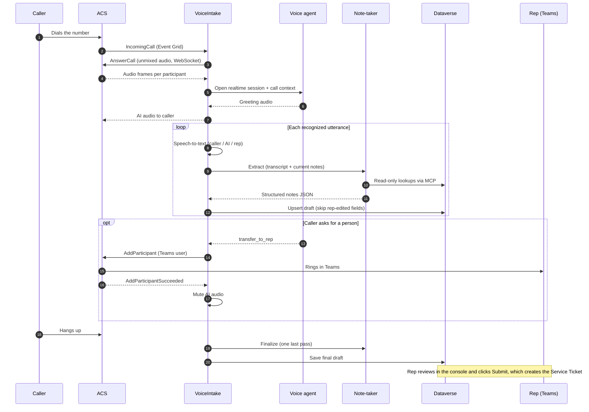

# 02 · Architecture

> Customer demo visual: [PNG preview](floorworks-live-intake-architecture.png) · [Editable Excalidraw source](floorworks-live-intake-architecture.excalidraw)

## System context

## Components

| Component | Technology | Responsibility |
|---|---|---|
| **Teams phone number (TPE)** | Teams Phone resource account, ACS *Teams Phone Extensibility* | Gives the business a normal phone number that routes into ACS instead of a person |
| **ACS Call Automation** | Azure Communication Services | Answers the call, streams audio over WebSocket, adds Teams participants, raises call events |
| **Event Grid** | Azure Event Grid | Delivers `Microsoft.Communication.IncomingCall` to `/api/incoming` |
| **VoiceIntake app** | .NET 8 minimal API on Azure Container Apps | The only service you run. See below |
| **Foundry voice agent** | Microsoft Foundry Voice Live agent `floorworks-voice-agent-app` | AI receptionist: speech in, speech out, tool calls, `transfer_to_rep` |
| **Foundry note-taker** | Foundry prompt agent `floorworks-notetaker` | Reads the transcript, returns structured notes as JSON; read-only on Dataverse |
| **Toolbox** | Foundry toolbox `floorworks-dataverse` | Packages the Dataverse MCP tools for the voice agent |
| **Dataverse MCP server** | `https://<org>.crm.dynamics.com/api/mcp` | Lets agents query manufacturing records |
| **Azure Speech** | Cognitive Services Speech | Transcribes each speaker separately |
| **Dataverse** | Power Platform | Stores the manufacturing data, drafts and tickets |

## Inside the VoiceIntake app

| Source file | Role |
|---|---|
| `Program.cs` | HTTP endpoints, the ACS WebSocket bridge, the voice-agent WebSocket client, per-speaker STT, the Rep API, reconnect handling |
| `Extractor.cs` | `CallState` (transcript, roles, flags) and the note-taker client; runs extract on new speech and finalize at call end |
| `Drafts.cs` | `DraftStore`: draft create/update, customer and equipment search, **Submit** (the only ticket creator) |
| `RepUi.cs` | The Rep Console HTML and JavaScript, embedded and served at `/rep` |

### HTTP surface

| Route | Method | Purpose |
|---|---|---|
| `/healthz` | GET | Liveness |
| `/api/incoming` | POST | Event Grid webhook. Validates the subscription and answers each incoming call |
| `/api/callbacks/{callId}` | POST | ACS call events (connected, participant added or failed, media failed) |
| `/ws/{callId}` | WebSocket | ACS unmixed audio in; AI audio out |
| `/events/{callId}` | GET (SSE) | Transcript and field events for any custom UI |
| `/rep` | GET | Rep Console (needs the rep key) |
| `/api/rep/calls` | GET | Live call ids and recent drafts |
| `/api/rep/draft/{callId}` | GET / POST | Read or edit a draft |
| `/api/rep/draft/{callId}/submit` | POST | Create the Service Ticket |
| `/api/rep/customers`, `/api/rep/equipment` | GET | Search helpers |

## Call lifecycle

## Key behaviors and why they exist

**Per-speaker transcription.** ACS sends *unmixed* audio, so the app runs one speech recognizer per participant and labels
lines `customer`, `assistant` or `rep`. This gives the note-taker clean speaker attribution.

**Audio format.** ACS delivers 24 kHz PCM; the voice agent speaks 24 kHz, but Speech STT runs at 16 kHz, so the app resamples
for transcription only. This resampling is why short product names can be misheard (see [Roadmap](10-roadmap.md)).

**AI mute after transfer.** When the rep joins, the app stops forwarding AI audio so the receptionist does not talk over
the human. If `AddParticipant` fails, the AI is un-muted and keeps helping the caller.

**Reconnect-safe.** ACS can close and reopen the media WebSocket mid-call. The app counts active sockets per call
(`ActiveWs`); finalize is skipped while any socket is open and waits four seconds after the last one closes. Shared call
state survives the reconnect.

**Draft versus ticket.** `DraftStore.SaveNotes` is the only writer from the agent side and it only touches
`bdm_servicerequestdraft`. `DraftStore.Submit` is called only from the rep API. Both agents' instructions forbid creating
or editing tickets, and the note-taker is also read-only by contract.

**Rep edits win.** Each draft stores `bdm_editedfields`, a comma-separated list. `SaveNotes` writes an agent field only
when it is not in that list and the new value is not empty.

**Customer and equipment linking.**
- Customer: matched by caller phone while the link is empty; the rep can search and pick.
- Equipment: from the note-taker's `matches`, with a fallback lookup by asset number; the rep can pick from the list.

## Identity map

| Caller | Callee | Mechanism |
|---|---|---|
| VoiceIntake | Foundry (voice and note-taker) | Container App managed identity (`DefaultAzureCredential`), scope `https://ai.azure.com/.default` |
| VoiceIntake | Dataverse | Same managed identity, registered as a Dataverse *application user* |
| Foundry agents | Dataverse MCP | Project connection `dataverse-mfg-mi` (project managed identity) |
| VoiceIntake | ACS | Connection string |
| VoiceIntake | Speech | Key and region |
| Rep browser | Rep Console | Shared rep key (`REP_KEY`) |

> A per-user OAuth connection (`dataverse-mfg`) exists but returns `CONSENT_REQUIRED` for unattended phone calls. Always use
> the managed-identity connection for agents that run on calls.
