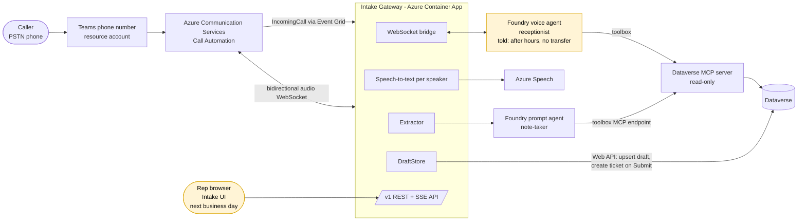
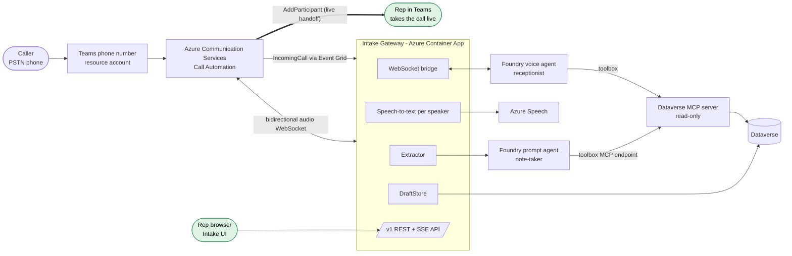
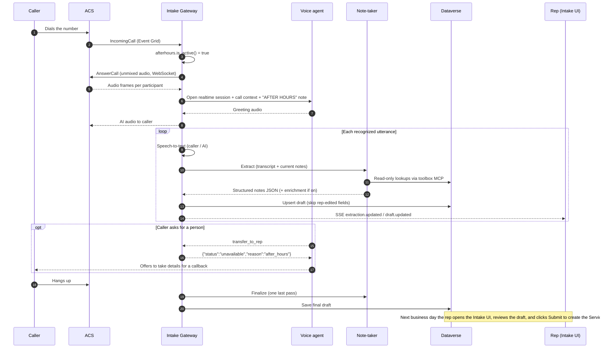
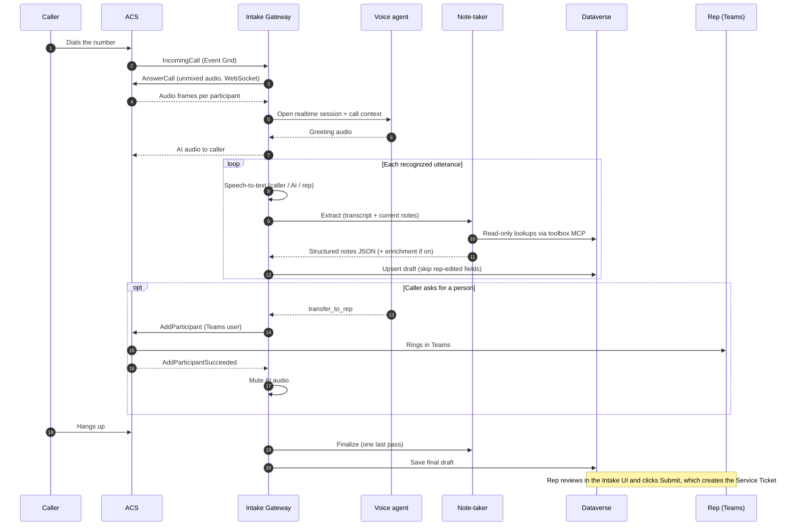

# 02 · Architecture

> Customer demo visual: [PNG preview](floorworks-live-intake-architecture.png) · [Editable Excalidraw source](floorworks-live-intake-architecture.excalidraw)
> (the diagram may still show the retired C# app; the Mermaid diagrams below are authoritative)

## System context

The same system runs in two modes, chosen per call by `AFTER_HOURS` (see [04 · Configuration](04-configuration.md)). Both share
every component; the only structural difference is whether a call can be transferred to a rep in Teams.

The only service you run is the **Intake Gateway** (`src\intake-gateway`, Python 3.12 / FastAPI, Azure Container Apps). It
bridges ACS audio to the Foundry voice agent, extracts notes with the note-taker, **persists the draft in Dataverse**, and
serves the `/v1` API used by the **Intake UI** (`src\intake-ui`, React). The C# `VoiceIntake` app in `src\VoiceIntake` is
retired; it is kept only as a reference.

### After-hours flow (no transfer)

The AI receptionist handles the whole call. `transfer_to_rep` is declined, so no Teams rep is involved; a rep reviews the
draft later in the Intake UI and submits it.

### Work-hours flow (transfer to a rep)

## Components

| Component | Technology | Responsibility |
|---|---|---|
| **Teams phone number (TPE)** | Teams Phone resource account, ACS *Teams Phone Extensibility* | Gives the business a normal phone number that routes into ACS instead of a person |
| **ACS Call Automation** | Azure Communication Services | Answers the call, streams audio over WebSocket, adds Teams participants, raises call events |
| **Event Grid** | Azure Event Grid | Delivers `Microsoft.Communication.IncomingCall` to `/api/incoming` |
| **Intake Gateway** | Python 3.12 / FastAPI on Azure Container Apps | The only service you run. See below |
| **Intake UI** | React 19 + Vite (static site) | Live transcript, extracted fields, AI enrichment, draft form, customer/equipment pickers, Save and Submit |
| **Foundry voice agent** | Microsoft Foundry Voice Live agent | AI receptionist: speech in, speech out, tool calls, `transfer_to_rep` |
| **Foundry note-taker** | Foundry prompt agent | Reads the transcript, returns structured notes (and optional enrichment) as JSON; read-only on Dataverse |
| **Toolbox** | Foundry toolbox | Packages the Dataverse MCP tools (`describe`, `read_query`, `search`); both agents use it so access is consistent |
| **Dataverse MCP server** | `https://<org>.crm.dynamics.com/api/mcp` | Lets agents query manufacturing records (read-only) |
| **Azure Speech** | Cognitive Services Speech | Transcribes each speaker separately |
| **Dataverse** | Power Platform | Stores the manufacturing data, drafts and tickets. Written only by the gateway |

## Inside the Intake Gateway

| Module (`app\`) | Role |
|---|---|
| `main.py` | FastAPI app: `/v1` API, SSE, ACS/Event Grid infra endpoints, draft and rep routes |
| `bridge.py` | ACS media WebSocket bridge, voice-agent session, transfer/hang-up, finalize on call end |
| `acs.py`, `security.py` | ACS Call Automation client; Event Grid secret, ACS JWT and per-call token checks |
| `transcribe.py`, `audio.py` | Per-speaker speech-to-text and resampling |
| `extractor.py` | Note-taker client: runs `extract` on new speech and `finalize` at call end; normalizes enrichment; calls the draft writer |
| `drafts.py` | `DraftStore` (Dataverse Web API): save notes, rep edits, customer and equipment search, create customer, **Submit** (the only ticket creator) |
| `functions.py`, `afterhours.py` | Voice-agent function calls (`transfer_to_rep`, ...) and the after-hours switch |
| `state.py` | In-memory call state and per-call event hub (SSE replay, webhook fan-out) |
| `webhooks.py`, `limits.py`, `validate.py`, `config.py` | Signed webhooks, call limits, startup validation, settings |

Call state (transcript, extracted fields, enrichment) is **in memory** and lost on restart. The durable record is the
Dataverse draft, which is why persistence matters.

### HTTP surface

Infra routes need no API key (they use Event Grid, ACS and per-call secrets). `/v1` routes need an API key
(`x-api-key`, `Authorization: Bearer`, or `?key=` for SSE).

| Route | Method | Purpose |
|---|---|---|
| `/healthz` | GET | Liveness and config errors |
| `/api/incoming` | POST | Event Grid webhook. Validates the subscription and answers each incoming call |
| `/api/callbacks/{callId}` | POST | ACS call events (connected, participant added or failed, media failed) |
| `/ws/{callId}` | WebSocket | ACS unmixed audio in; AI audio out |
| `/v1/calls`, `/v1/calls/{id}` | GET | List calls; status, fields, enrichment |
| `/v1/calls/{id}/transcript`, `/extraction` | GET | Transcript lines; extracted fields |
| `/v1/calls/{id}/events` | GET (SSE) | Transcript, extraction, enrichment and `draft.updated` events |
| `/v1/calls/{id}/transfer`, `/hangup` | POST | Rep actions |
| `/v1/drafts`, `/v1/tickets` | GET | List drafts and tickets (503 unless `DATAVERSE_URL` is set) |
| `/v1/drafts/{callId}` | GET / POST | Read a draft with customer candidates and enrichment; rep edit |
| `/v1/drafts/{callId}/customer` | POST | Create a customer and link it |
| `/v1/drafts/{callId}/submit` | POST | Create the Service Ticket |
| `/v1/customers?q=`, `/v1/equipment` | GET | Search helpers |
| `/v1/config`, `/v1/stats`, `/v1/functions` | GET | Introspection |

## Call lifecycle

### After-hours call

### Work-hours call

## Key behaviors and why they exist

**Per-speaker transcription.** ACS sends *unmixed* audio, so the gateway runs one speech recognizer per participant and
labels lines `customer`, `assistant` or `rep`. This gives the note-taker clean speaker attribution.

**Audio format.** ACS delivers 24 kHz PCM; the voice agent speaks 24 kHz, but Speech STT runs at 16 kHz, so the gateway
resamples for transcription only. This resampling is why short product names can be misheard (see [Roadmap](10-roadmap.md)).

**AI mute after transfer.** When the rep joins, the gateway stops forwarding AI audio so the receptionist does not talk over
the human. If `AddParticipant` fails, the AI is un-muted and keeps helping the caller.

**Reconnect-safe.** ACS can close and reopen the media WebSocket mid-call. The gateway counts active sockets per call;
finalize is skipped while any socket is open. Shared call state survives the reconnect.

**Draft versus ticket.** The gateway is the only writer to Dataverse. `DraftStore.save_notes` runs after each extraction and
only touches `bdm_servicerequestdraft`. `DraftStore.submit` runs only from the rep's Submit click and is the only code that
creates a `bdm_serviceticket`. Both agents are read-only (toolbox allowlist is `describe`, `read_query`, `search`) and their
instructions forbid creating or editing records.

**Persistence is opt-in.** Drafts are written only when `DATAVERSE_URL` is set. Without it the gateway still runs calls, but
extraction stays in memory and the `/v1/drafts` routes return 503.

**Rep edits win.** Each draft stores `bdm_editedfields`, a comma-separated list. `save_notes` writes an agent field only
when it is not in that list and the new value is not empty. Once a draft is submitted it is never changed again.

**Customer and equipment linking.**
- Customer: matched by caller phone while the link is empty; the rep can see ranked suggestions, search, pick or create one.
- Equipment: from the note-taker's `matches`, with a fallback lookup by asset number; the rep can pick from the list.

**Optional enrichment.** With `ENRICHMENT=on`, the note-taker also returns a separate enrichment block (likely cause,
bulletin, parts, suggested priority, steps, sources) grounded in Foundry IQ. It is stored in `bdm_enrichmentjson`, shown as an
"AI suggested" card, and copied into the ticket notes on Submit. It never overwrites caller-said fields.

## Identity map

| Caller | Callee | Mechanism |
|---|---|---|
| Intake Gateway | Foundry (voice and note-taker) | Container App managed identity (`DefaultAzureCredential`), scope `https://ai.azure.com/.default` |
| Intake Gateway | Dataverse Web API | Same managed identity, scope `<org>/.default`, registered as a Dataverse *application user* with a role on the `bdm_*` tables |
| Foundry agents | Dataverse MCP | Toolbox / project connection using the project managed identity |
| Intake Gateway | ACS | Connection string |
| Intake Gateway | Speech | Key and region, or AAD (`SPEECH_AUTH`) |
| Event Grid, ACS | Gateway infra routes | `EVENTGRID_SECRET`, ACS-signed JWT, per-call HMAC tokens (`GATEWAY_SECRET`) |
| Intake UI / API consumers | `/v1` API | API key (`API_KEYS`) |

> A per-user OAuth connection can return `CONSENT_REQUIRED` for unattended phone calls. Always use the managed-identity
> connection for agents that run on calls.
