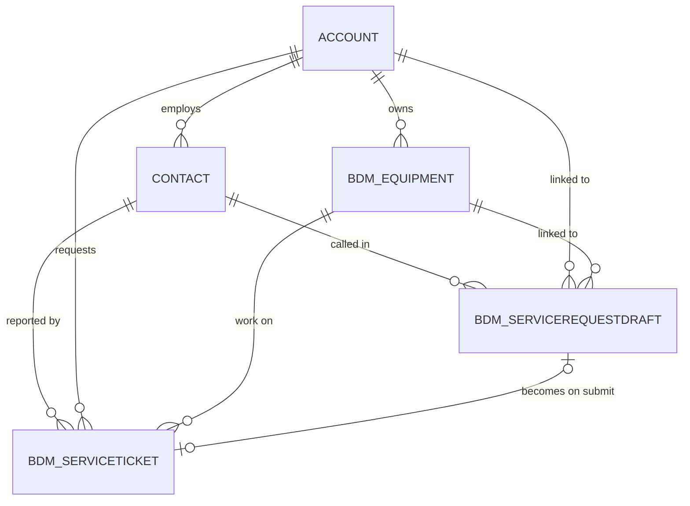

# 05 · Data model

Customers are the standard Dataverse **Account** table. Equipment, tickets and drafts are custom tables with the
publisher prefix `bdm_` in the default profile. `dataverse/provision-dataverse.ps1` creates missing supported-profile
schema and required draft/journal integrity structures; sample data is opt-in. `dataverse/config.json` names the
table roles; see [18 · Table configuration](18-table-configuration.md).

## Entity relationships

The lookup to Account is named `bdm_CustomerId` on equipment, tickets and drafts. Drafts and tickets also have a
`bdm_ContactId` lookup to the standard Contact table (the person who called). Equipment belongs to the account, not the person.

## Tables

### `account` — Customer (standard table)
Used as is: `name`, `accountnumber`, `telephone1`-`telephone3` (the caller is matched on these), `emailaddress1`.

### `contact` — Caller (standard table, optional role)
Used as is: `fullname`, `mobilephone` and `telephone1`-`telephone3` (the caller is matched on these), `emailaddress1`,
`parentcustomerid` (the Account). Matching tries contacts first, then the account's own phones; a unique contact match
resolves to its account and is stored on the draft. The role is optional: remove `"contact"` from `roles` in
`dataverse\config.json` and the gateway uses the account phone only. The voice agent may state a matched name only as a
confirming question ("Am I speaking with ...?").

### `bdm_equipment` — Equipment
Manufacturing assets on the plant floor.

| Column | Type | Notes |
|---|---|---|
| `bdm_name` | Text (primary) | e.g. "CNC Mill 3" |
| `bdm_assetnumber` | Text 50 | e.g. `EQ-1003` |
| `bdm_plant` | Text 100 | Site / location |
| `bdm_manufacturer` | Text 100 | |
| `bdm_status` | Choice | Operational, Degraded, Down, Under Maintenance |
| `bdm_installdate` | Date | |
| `bdm_customerid` | Lookup → Account | Owner |

### `bdm_serviceticket` — Service Ticket
The real work order. **Created only by a rep's Submit.**

| Column | Type | Notes |
|---|---|---|
| `bdm_name` | Text (primary) | Ticket title |
| `bdm_priority` | Choice | Low, Normal, High, Urgent |
| `bdm_status` | Choice | Open, In Progress, Waiting for Parts, Resolved |
| `bdm_description` | Multiline | Complaint plus customer, contact phone, location, preferred time |
| `bdm_assignedtechnician` | Text 100 | |
| `bdm_openedon` | Date and time | |
| `bdm_customerid` | Lookup → Account | |
| `bdm_equipmentid` | Lookup → Equipment | |
### `bdm_servicerequestdraft` — Service Request Draft
The live, persisted draft the agents build and the rep reviews. One row per call (`bdm_callid`).

| Column | Type | Notes |
|---|---|---|
| `bdm_name` | Text (primary) | Draft title |
| `bdm_callid` | Text 100 | Links the draft to the call and the console URL |
| `bdm_callerphone` | Text 30 | Caller ID from ACS |
| `bdm_customername` | Text 200 | Name as heard |
| `bdm_contactphone` | Text 30 | Defaults to caller phone |
| `bdm_equipmenttext` | Text 200 | Equipment as heard |
| `bdm_assetnumber` | Text 100 | |
| `bdm_location` | Text 200 | |
| `bdm_preferredtime` | Text 200 | |
| `bdm_complaint` | Multiline 4000 | |
| `bdm_priority` | Choice | Low, Normal, High, Urgent |
| `bdm_summary` | Multiline 4000 | Running call summary |
| `bdm_transcript` | Multiline 100000 | Full labeled transcript |
| `bdm_transcriptversion` | Integer | Last transcript checkpoint mirrored into this draft |
| `bdm_coaching` | Multiline 2000 | Suggested next question for the rep |
| `bdm_status` | Choice | **Draft**, Submitted, Discarded |
| `bdm_submittedby`, `bdm_submittedon` | Text, Date | Filled on submit |
| `bdm_editedfields` | Text 300 | Comma list of rep-edited fields; agents will not overwrite these |
| `bdm_enrichmentjson` | Memo | Foundry IQ "AI suggested" block (likely cause, bulletin, parts, priority, steps, sources). Written only when `ENRICHMENT=on`; separate from caller-said fields |
| `bdm_customerid` | Lookup → Account | |
| `bdm_equipmentid` | Lookup → Equipment | |
| `bdm_ticketid` | Lookup → Service Ticket | Set on submit |

The draft requires optimistic concurrency and an **Active single-column alternate key on `bdm_callid`**.
The provisioner waits for activation; duplicate existing IDs must be reconciled explicitly, not deleted by the script.

### `bdm_calljournal` - Internal gateway checkpoints

| Column | Type | Purpose |
|---|---|---|
| `bdm_callid` | Text | Call identity |
| `bdm_checkpointjson` | Multiline 1000000 | Serializable call/transcript/extraction checkpoint |
| `bdm_version` | Integer | Checkpoint concurrency/version tracking |
| `bdm_complete` | Boolean | Completed versus unfinished recovery work |

Journal optimistic concurrency is required. The gateway application user needs read/create/write access; the
journal is **not exposed as an agent tool**. Completed-row retention/deletion is an operator policy, coordinated
with drafts/logs. Committed checkpoints recover notes/extraction, not live calls.

## Option values

Choice columns use the publisher base value **105730000** plus the index.

| Choice | Values |
|---|---|
| Priority | Low `…000`, Normal `…001`, High `…002`, Urgent `…003` |
| Draft status | Draft `…000`, Submitted `…001`, Discarded `…002` |

The note-taker speaks *Low / Medium / High / Critical*; the app maps these to Low / Normal / High / Urgent.

## Using different table or column names

The intake gateway does not hardcode the `bdm_*` names at the Dataverse boundary. A customer whose environment uses
other names supplies a partial JSON override (`DATAVERSE_SCHEMA` / `DATAVERSE_SCHEMA_FILE`, see
[04](04-configuration.md)) mapping each canonical name above (tables, columns, lookup navigation properties such as
`bdm_CustomerId`) and optionally the status and priority option values. Lookup value columns
(`_bdm_customerid_value`) follow the renamed lookup. One canonical name maps to one real name across all tables.
Required integrity columns/relationships must remain available. A `columns` section scopes a mapping to one table
(so `bdm_name` can be `name` on customers and `title` on tickets); `null` can disable supported optional columns,
**not** mandatory draft/journal integrity fields.

### Choosing tables

There is one config file, `dataverse\config.json`. Its `roles` name the table for each role (customer, ticket,
equipment, draft, and optionally contact); the gateway derives the columns, lookups and option values from the org metadata. Any key written
explicitly overrides what is derived. The provisioner supports its standard/custom profiles, including linking drafts
to Cases when `"ticket": "incident"` and Customer Service is available. It is not a discovery-first migration engine
for arbitrary existing customer tables; review compatibility and approve required schema additions before running it.
Keep the configured account/contact phone columns filled in for caller matching.

## Extending the model

1. Review `dataverse\config.json` and approved schema changes; provision compatible columns/relationships.
2. Update gateway mappings in `app\schema.py`/metadata discovery and persistence in `app\drafts.py`.
3. Keep typed mutation/extraction contracts (`api_models.py`, `extraction_models.py`) and React form/API types consistent.
4. Update the note-taker prompt/output schema, republish agents and redeploy gateway configuration.
5. Add focused regressions for protected rep edits/clears, concurrency, relationships, Submit and checkpoint recovery.

Do not grant agents write tools, bypass atomic Submit or disable integrity checks to accommodate a new profile.

## Seed data

The seed also creates 10 contacts (2 on FloorWorks, 1-2 on each other account) with mobile numbers in mixed formats.

| Equipment | Asset # | Plant | Status |
|---|---|---|---|
| CNC Mill 3 | EQ-1003 | Grand Rapids, MI | Operational |
| Injection Press 2 | EQ-2002 | Monterrey, MX | Degraded |
| Robotic Welder R7 | EQ-3007 | Grand Rapids, MI | Operational |
| Packaging Line A | EQ-4001 | Brussels, BE | Under Maintenance |
| Hydraulic Press H1 | EQ-5001 | Monterrey, MX | Down |
| Heat Treat Furnace F2 | EQ-6002 | Brussels, BE | Operational |

Seven accounts are seeded (FloorWorks owns CNC Mill 3, Robotic Welder R7 and Hydraulic Press H1; Contoso Plastics, Adventure Works Packaging and Litware Thermal Systems own the rest) plus 6 tickets linked to their account and equipment. FloorWorks (`ACC-1000`) has telephone `(405) 602-9804`; to link a different caller automatically, put their number on an account's `telephone1`.
