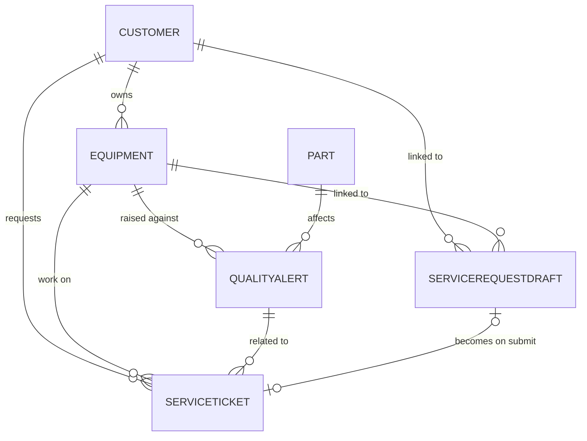
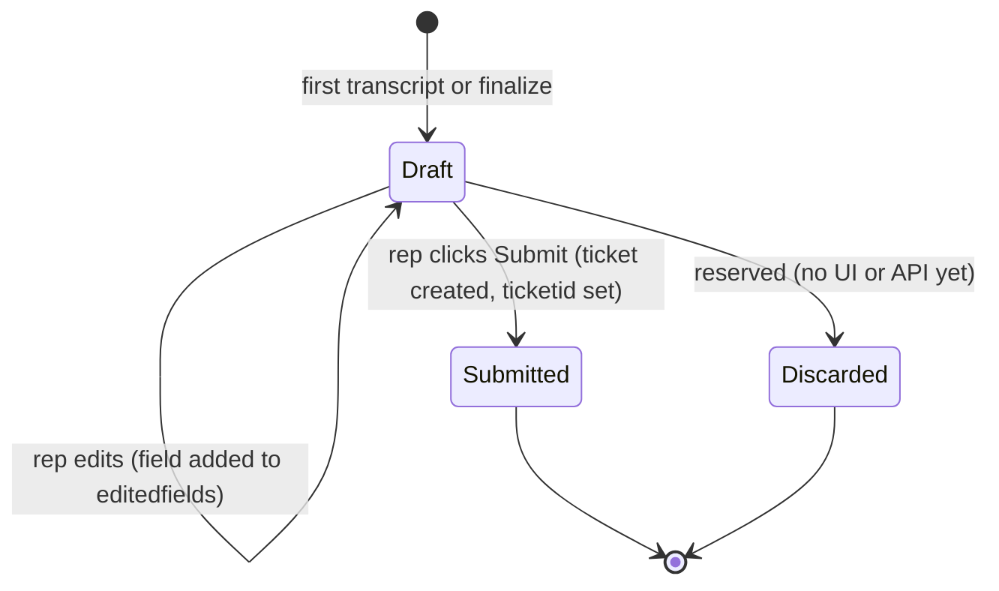

# 05 · Data model

All tables use the publisher prefix `bdm_`. They are created by `dataverse/provision-dataverse.ps1`, which is idempotent:
it creates missing tables, columns and relationships, and seeds sample rows by name.

## Entity relationships

## Tables

### `bdm_equipment` — Equipment
Manufacturing assets on the plant floor.

| Column | Type | Notes |
|---|---|---|
| `bdm_name` | Text (primary) | e.g. "CNC Mill 3" |
| `bdm_assetnumber` | Text 50 | e.g. `EQ-1003` |
| `bdm_plant` | Text 100 | Site / location |
| `bdm_manufacturer` | Text 100 | |
| `bdm_status` | Choice | Operational, Degraded, Down, Under Maintenance |
| `bdm_installdate` | Date | |
| `bdm_customerid` | Lookup → Customer | Owner |

### `bdm_part` — Part

| Column | Type | Notes |
|---|---|---|
| `bdm_name` | Text (primary) | |
| `bdm_partnumber` | Text 50 | |
| `bdm_supplier` | Text 100 | |
| `bdm_category` | Choice | Hydraulic, Electrical, Mechanical, Fastener, Consumable |
| `bdm_unitcost` | Decimal | USD |

### `bdm_qualityalert` — Quality Alert

| Column | Type | Notes |
|---|---|---|
| `bdm_name` | Text (primary) | Alert title |
| `bdm_severity` | Choice | Low, Medium, High, Critical |
| `bdm_status` | Choice | New, Investigating, Contained, Closed |
| `bdm_description` | Multiline | |
| `bdm_defectcount` | Whole number | |
| `bdm_detectedon` | Date and time | |
| `bdm_partid` | Lookup → Part | |
| `bdm_equipmentid` | Lookup → Equipment | |

### `bdm_serviceticket` — Service Ticket
The real work order. **Created only by a rep's Submit.**

| Column | Type | Notes |
|---|---|---|
| `bdm_name` | Text (primary) | Ticket title |
| `bdm_priority` | Choice | Low, Normal, High, Urgent |
| `bdm_status` | Choice | Open, In Progress, Waiting for Parts, Resolved |
| `bdm_description` | Multiline | Complaint plus customer, contact phone, location, preferred time |
| `bdm_assignedtechnician` | Text 100 | |
| `bdm_openedon` | Date and time | |
| `bdm_customerid` | Lookup → Customer | |
| `bdm_equipmentid` | Lookup → Equipment | |
| `bdm_qualityalertid` | Lookup → Quality Alert | |

### `bdm_customer` — Customer

| Column | Type |
|---|---|
| `bdm_name` (account name, primary), `bdm_accountnumber`, `bdm_firstname`, `bdm_lastname` | Text |
| `bdm_primaryphone`, `bdm_email` | Text |
| `bdm_street`, `bdm_city`, `bdm_state`, `bdm_zip` | Text |

### `bdm_servicerequestdraft` — Service Request Draft
The live, persisted draft the agents build and the rep reviews. One row per call (`bdm_callid`).

| Column | Type | Notes |
|---|---|---|
| `bdm_name` | Text (primary) | Draft title |
| `bdm_callid` | Text 100 | Links the draft to the call and the console URL |
| `bdm_callerphone` | Text 30 | Caller ID from ACS |
| `bdm_customername` | Text 200 | Name as heard |
| `bdm_contactphone` | Text 30 | Defaults to caller phone |
| `bdm_equipmenttext` | Text 200 | Equipment as heard |
| `bdm_assetnumber` | Text 100 | |
| `bdm_location` | Text 200 | |
| `bdm_preferredtime` | Text 200 | |
| `bdm_complaint` | Multiline 4000 | |
| `bdm_priority` | Choice | Low, Normal, High, Urgent |
| `bdm_summary` | Multiline 4000 | Running call summary |
| `bdm_transcript` | Multiline 100000 | Full labeled transcript |
| `bdm_coaching` | Multiline 2000 | Suggested next question for the rep |
| `bdm_status` | Choice | **Draft**, Submitted, Discarded |
| `bdm_submittedby`, `bdm_submittedon` | Text, Date | Filled on submit |
| `bdm_editedfields` | Text 300 | Comma list of rep-edited fields; agents will not overwrite these |
| `bdm_enrichmentjson` | Memo | Foundry IQ "AI suggested" block (likely cause, bulletin, parts, priority, steps, sources). Written only when `ENRICHMENT=on`; separate from caller-said fields |
| `bdm_customerid` | Lookup → Customer | |
| `bdm_equipmentid` | Lookup → Equipment | |
| `bdm_ticketid` | Lookup → Service Ticket | Set on submit |

## Option values

Choice columns use the publisher base value **105730000** plus the index.

| Choice | Values |
|---|---|
| Priority | Low `…000`, Normal `…001`, High `…002`, Urgent `…003` |
| Draft status | Draft `…000`, Submitted `…001`, Discarded `…002` |

The note-taker speaks *Low / Medium / High / Critical*; the app maps these to Low / Normal / High / Urgent.

## Seed data

| Equipment | Asset # | Plant | Status |
|---|---|---|---|
| CNC Mill 3 | EQ-1003 | Grand Rapids, MI | Operational |
| Injection Press 2 | EQ-2002 | Monterrey, MX | Degraded |
| Robotic Welder R7 | EQ-3007 | Grand Rapids, MI | Operational |
| Packaging Line A | EQ-4001 | Brussels, BE | Under Maintenance |
| Hydraulic Press H1 | EQ-5001 | Monterrey, MX | Down |
| Heat Treat Furnace F2 | EQ-6002 | Brussels, BE | Operational |

Parts, quality alerts, tickets and customers are also seeded; see the script for the full set. To make a phone-number
demo link a customer automatically, add a `bdm_customer` row whose `bdm_primaryphone` equals the caller's number in
E.164 format.

## Lifecycle of a draft

Submitted drafts are read-only: agent writes are ignored and rep edits or a second submit are rejected. The *Discarded*
value exists in the schema but nothing sets it yet (see the [roadmap](10-roadmap.md)).

## Extending the model

Add columns in `provision-dataverse.ps1` (the helpers `StrAttr`, `MemoAttr`, `PickAttr`, ... are idempotent), then update
`DraftSelect` and `Update()` in `Drafts.cs`, the form in `RepUi.cs`, and the note-taker's output schema in
`foundry/notetaker-instructions.md`.
