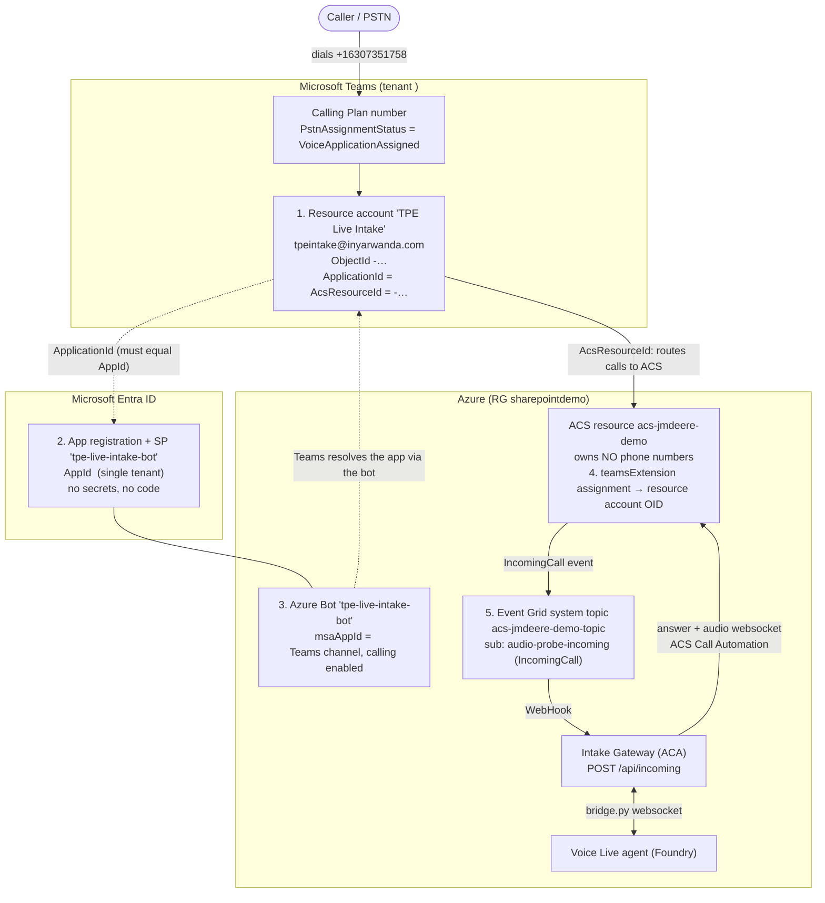

# 13 – Telephony wiring: number → Teams → bot → ACS → gateway

How a call to `+1 630 735 1758` reaches the Intake Gateway, and which Teams/Entra/Azure objects make that work. This is the connecting pillar of the architecture. To rebuild it, see [15-telephony-binding-runbook.md](15-telephony-binding-runbook.md).

## Diagram

## The five links

| # | Object | Where | Role |
|---|---|---|---|
| 1 | Resource account "TPE Live Intake", OID `<resource-account-object-id>` | Teams + Entra user | Holds the number; `ApplicationId` and `AcsResourceId` set via `Set-CsOnlineApplicationInstance` |
| 2 | App `tpe-live-intake-bot`, AppId `<current-app-id>` | Entra, single tenant | Third-party bot identity Teams requires |
| 3 | Azure Bot `tpe-live-intake-bot` (SingleTenant, F0, global), `msaAppId` = AppId | Azure | Lets Teams resolve the ApplicationId to a bot with calling enabled |
| 4 | ACS `teamsExtension` assignment: resource account OID → ACS resource `acs-jmdeere-demo` (immutable ID `<acs-immutable-resource-id>`) | Azure/ACS | Authorizes ACS to receive calls for that account |
| 5 | Event Grid subscription `audio-probe-incoming` → `https://floorworks-intake-gateway…/api/incoming` | Azure | The only link into our code |

**Invariant:** resource account `ApplicationId` == Entra `AppId` == bot `msaAppId`. If one changes, the others must be recreated to match. The ACS first-party service principal `1fd5118e-2576-4263-8130-9503064c837a` must also exist in the tenant.

History of AppIds: `<original-app-id>` (original), `<first-rebuild-app-id>` (first rebuild), `<current-app-id>` (current, second rebuild, call verified).

## How the link was made (per Microsoft docs)

Source: [Teams Phone extensibility quick start](https://learn.microsoft.com/azure/communication-services/quickstarts/tpe/teams-phone-extensibility-quickstart#quick-start).

1. **Create the app and the Azure Bot** (`infra\rebind-tpe-azure.ps1 -Action CreateApp`). The doc says "The ApplicationId parameter is your third party bot ID". In practice the app alone is not enough: with the app but no bot, calls fail with SIP 480 and no `IncomingCall` is raised (seen in the first rebuild).
2. **Create the resource account**: `New-CsOnlineApplicationInstance -UserPrincipalName … -ApplicationId <AppId>`.
3. **Bind it to ACS**: `Set-CsOnlineApplicationInstance -Identity … -ApplicationId … -AcsResourceId <ACS immutable id>`. Not visible in the ACS portal.
4. **Sync**: `Sync-CsOnlineApplicationInstance -ObjectId <resource account> -ApplicationId …`.
5. **Assign the number** to the resource account (Calling Plan number, `VoiceApplicationAssigned`).
6. **Create the ACS assignment** and the Event Grid subscription (`-Action Assign`, `-Action Subscribe`).

`teams\rebind-tpe.ps1` does steps 2–4; `infra\rebind-tpe-azure.ps1` does 1, 6 and teardown.

Foundry's channel flow ([Integrate telephony channels with a voice agent](https://learn.microsoft.com/azure/foundry/agents/how-to/voice-agent-telephony-channels)) uses the same inputs: ACS resource, phone number, resource account object ID. Whether it also requires the Azure Bot has not been verified.

## What our app does and does not know

- The gateway never references the number, the resource account, or the AppId.
- Only link into our code: Event Grid subscription `audio-probe-incoming` on `acs-jmdeere-demo-topic`.
- The gateway handles every `IncomingCall` on that ACS resource and logs `IncomingCall to=… toRaw=… from=…`.
- Only Teams ID in code: `TRANSFER_TEAMS_OBJECT_IDS` (rep user, for transfer).

## Implications

- Moving the Event Grid subscription to a Foundry channel `incoming_call_url` would hand this number to Foundry; both cannot own it on the same ACS resource.
- The app and the bot are a pair. Deleting or recreating the app without recreating the bot (or the reverse) breaks inbound calls (SIP 480 "temporarily unavailable").
- Diagnosis: SIP 480, no `IncomingCall` event and no gateway log line means the problem is in the Teams/bot layer, not in Azure or the gateway.
- Teams readback right after a rebind may show a stale ApplicationId for several minutes; test with a real call.
