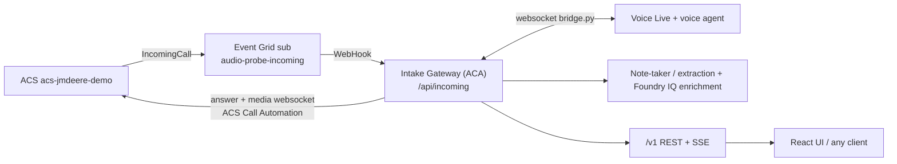
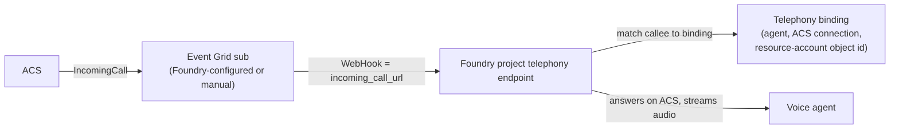

# 14 – Telephony binding: Teams/ACS + Event Grid (ours) vs Foundry channel

This is the core design choice behind the intake solution: **who answers the phone call and owns the audio session**.

Both options share the same Teams-side plumbing. They differ only in what is behind the ACS `IncomingCall` event.

## 1. What is common to both (done once, in Teams/Entra/ACS)

| Step | Object | Our value |
|---|---|---|
| Number | Teams Calling Plan number assigned to a resource account | `+16307351758` |
| Resource account | Entra user / Teams application instance | `<resource-account-object-id>` |
| Bot identity | Entra app `tpe-live-intake-bot` (the "third-party bot ID") | AppId `<current-app-id>` |
| Azure Bot | Azure Bot with the same `msaAppId` and Teams calling enabled; required in our tenant (without it: SIP 480) | `tpe-live-intake-bot` |
| ACS assignment | `teamsExtension` assignment of the resource account to ACS | OID `<redacted-id>-…` |
| ACS link | `AcsResourceId` on the application instance (`Set-CsOnlineApplicationInstance`) | `<redacted-id>-…` = `acs-jmdeere-demo` |
| Result | ACS emits `Microsoft.Communication.IncomingCall` for the number | system topic `acs-jmdeere-demo-topic` |

Docs: [TPE quick start](https://learn.microsoft.com/azure/communication-services/quickstarts/tpe/teams-phone-extensibility-quickstart) and [Foundry telephony channels – Prepare Teams Phone extensibility](https://learn.microsoft.com/azure/foundry/agents/how-to/voice-agent-telephony-channels). The Foundry doc requires exactly this same preparation.

Everything below starts at the point where ACS has an `IncomingCall` event.

## 2. Option A – Our approach: Event Grid → Intake Gateway (implemented)

- **Binding** = an Event Grid subscription we own. There is no Foundry binding.
- **Our code answers the call** (Call Automation), bridges audio to Voice Live, and sees the audio and transcript itself.
- That is what lets the gateway do live notes (Azure Speech), extraction, enrichment, call limits, rep transfer and the `/v1` API.
- The voice agent is just a Voice Live endpoint we connect to (`…/agents/{voice_agent}/endpoint/protocols/voice`).

## 3. Option B – Foundry channel binding

- **Binding** = a Foundry object created per agent (portal → agent → Channels → Phone numbers, or `telephony.create_binding`). Inputs: ACS project connection, resource-account object ID (Foundry builds `28:orgid:<id>`), optional number.
- Foundry returns `incoming_call_url`. The Event Grid subscription is pointed at it (Foundry can auto-configure it, including a secure webhook app and app roles).
- **Foundry answers the call**, runs the agent and gets the Foundry-side traces and conversations. Our code is not in the audio path.
- It is **preview** (`Foundry-Features: VoiceAgents=V1Preview`). It needs a project managed identity with access to ACS, and the Foundry project and ACS must be in the same Entra tenant. It also supports outbound call jobs and Twilio.

## 4. Side-by-side

| Dimension | A: Event Grid → our gateway | B: Foundry channel binding |
|---|---|---|
| Who answers the call | Our gateway (ACS Call Automation) | Foundry |
| Event Grid target | `https://<gateway>/api/incoming` | Foundry `incoming_call_url` |
| Where the binding is stored | Event Grid subscription (Azure) | Foundry telephony binding (per agent) |
| Teams/Entra setup | Identical | Identical |
| Audio / transcript visibility to our code | Full | None, unless Foundry exposes it |
| Foundry portal traces for the call | No (agent Channels shows "No numbers yet") | Yes |
| Live notes, extraction, enrichment, REST/SSE API | Built in | Must be added another way (post-call fetch, tools or webhooks) |
| Call limits, rep transfer, custom routing | Ours to implement (done) | Limited to what Foundry offers |
| Maturity | GA APIs (ACS, Event Grid) | Preview |
| Effort and ownership | We maintain call handling | Minimal code, managed by Foundry |
| Reusable by other CCaaS or non-Foundry clients | Yes, a generic `/v1` gateway | Tied to Foundry agents |
| Fit with Teams auto attendants and queues | Possible, but we handle transfers | Documented as a destination in an existing call flow |

## 5. Hard constraints

- **One owner per number.** One ACS `IncomingCall` stream and one number cannot be handled by both a gateway subscription and a Foundry binding. Choose one per number or ACS resource. The earlier "two agents, no traces on one" problem was this conflict.
- **The Foundry "Channels" tab shows only Option B bindings.** Under Option A it correctly shows no numbers.
- **`tpe-live-intake-bot` is needed by both.** It is the identity that makes the resource account valid for TPE. The Entra app and the Azure Bot are a pair: recreate them together and re-point the resource account (see doc 15). Whether Option B also needs the Azure Bot is unverified.

## 6. How we decide (our brain)

| If the goal is… | Choose |
|---|---|
| A generic, UI-less intake API that any front end or CCaaS can consume, with live notes, structured extraction, Foundry IQ enrichment and Dataverse write | **A (current)** |
| A voice agent answering with minimal custom code, Foundry traces and evals on the real call | **B** |
| Both: Foundry-native voice plus our extraction | **B for the call + the gateway as a downstream consumer** (see section 7). Post-call extraction is documented as feasible. Live in-call notes are not documented. |

## 7. Does Foundry already do what the gateway does?

Partly. For the telephony half, yes: Foundry answers the call on ACS, matches the callee to a binding and streams audio to the agent, which is what `/api/incoming` plus `bridge.py` do. It does not do extraction, enrichment, Dataverse write, `/v1` API, limits or transfer.

What the docs say about reading a call back ([Voice agent observability](https://learn.microsoft.com/azure/foundry/agents/concepts/voice-agent-observability#read-stored-conversations), [voice agent quickstart](https://learn.microsoft.com/azure/foundry/agents/quickstarts/prompt-voice-agent#read-the-conversation-back)):

- With persistence enabled (`store: true` on the agent definition), Foundry saves the **transcript, event timeline and raw audio**. They can be read afterwards by conversation ID. Tracing is separate: one trace per conversation, in Application Insights.
- So a hybrid works **post-call**: Foundry owns the call, and a worker fetches the stored conversation and runs our extraction, enrichment and Dataverse draft.
- **Not documented:** a live transcript or event feed during the call, and how the conversation ID of a telephony call is surfaced to a consumer. Live notes in the rep UI (our current behaviour) would not be available under B unless this exists.
- Not tested in our tenant. Validate on a second number or ACS resource before committing to B.

## 8. Switching

- **A → B**: create the binding, repoint (or let Foundry replace) the Event Grid subscription to `incoming_call_url`. The gateway stops receiving calls. Its `/v1` API and UI keep working only for simulated calls.
- **B → A**: repoint Event Grid to `https://floorworks-intake-gateway…/api/incoming` and suspend or delete the binding (`status: suspended` stops new inbound calls without deleting it).
- Rollback to the old .NET app is a third Event Grid target: `https://floorworks-voice-intake…/api/incoming`.

## 9. Alignment with the Azure-Samples call-center-voice-agent-accelerator

Compared against [Azure-Samples/call-center-voice-agent-accelerator](https://github.com/Azure-Samples/call-center-voice-agent-accelerator) (README, `acs/event_handler.py`, `voicelive_media_handler.py`, `call_manager.py`, `docs/production-readiness.md`).

**Same pattern:** ACS `IncomingCall` → Event Grid webhook → ACA Python service → `answer_call` with bidirectional WebSocket media → Voice Live. Both validate the Event Grid handshake, cap concurrent/long/idle calls, keep call state in memory (one replica), and log to Log Analytics. Neither uses the Foundry telephony channel; the accelerator stores no transcripts.

| Area | Accelerator | Ours |
|---|---|---|
| Voice agent | Inline `session.update` assistant (Foundry agent optional per README) | Named Foundry agent via project agent endpoint |
| Output | Audio + transcript to client | Live notes, extraction, Foundry IQ enrichment, Dataverse draft, `/v1` REST+SSE, React UI, rep transfer |
| Telephony | 7 providers via a registry | ACS only (Teams number via resource account) |
| Deployment | `azd up` + Bicep, auto Event Grid subscription, Key Vault, managed identity, App Insights | Manual CLI steps |
| Tracing | `cid` on every log line | Call ID logged in places; make consistent |

**Gaps to close (from their production-readiness guide):**
- [ ] Bicep/azd (or script) that creates the Event Grid subscription and infra
- [ ] Key Vault for the ACS connection string and `gw-demo-key`; lock CORS
- [ ] `cid` on every log line
- [ ] Alerts: rejected calls, idle disconnects, Voice Live failures, webhook 4xx/5xx, restarts
- [ ] Load-test concurrent calls; set the call cap below the degradation point and check Voice Live quota
- [ ] Redis TTL state before running more than one replica
- [ ] Note that a redeploy drops active calls
- [ ] Privacy review: caller consent, log retention, PII in webhook payloads

## Sources

- [Azure-Samples/call-center-voice-agent-accelerator](https://github.com/Azure-Samples/call-center-voice-agent-accelerator)
- [Integrate telephony channels with a voice agent](https://learn.microsoft.com/azure/foundry/agents/how-to/voice-agent-telephony-channels)
- [Voice agent tracing, monitoring, and evaluation](https://learn.microsoft.com/azure/foundry/agents/concepts/voice-agent-observability)
- [Teams Phone extensibility quick start](https://learn.microsoft.com/azure/communication-services/quickstarts/tpe/teams-phone-extensibility-quickstart)
- Wiring evidence: `docs\13-telephony-wiring.md`

> Current AppId: `<current-app-id>` (history in [13-telephony-wiring.md](13-telephony-wiring.md)). Rebuild steps: [15-telephony-binding-runbook.md](15-telephony-binding-runbook.md).
