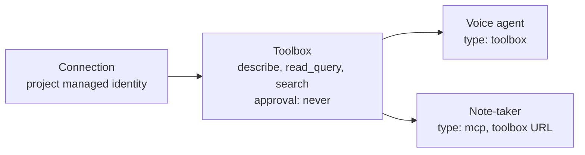

# 17 - Agent setup (`foundry/setup-agents.ps1`)

One script prepares a Foundry project for the intake gateway: the Dataverse connection, one shared toolbox, the note-taker agent and the voice agent. It reads everything back and proves that tool calls run **without approval**, because nobody can click "approve" during a phone call.

Run it **before** the gateway ([16](16-intake-gateway-deploy.md)). It prints the agent names and project endpoint that the gateway settings need.

## Prerequisites

| Need | Detail |
|---|---|
| Foundry project | Account and project already exist, with a chat model deployed (for example `gpt-5.6-sol`). The voice agent uses `gpt-realtime-2.1` by default |
| Your role | Contributor (or Azure AI Project Manager) on the Foundry account |
| Dataverse access for the project identity | The project's **managed identity** needs an application user in the Dataverse environment ([12](12-dataverse-mcp-managed-identity-setup.md)). Either a Dataverse admin does it once, or add `-GrantDataverseAccess` and run as an admin |
| Dataverse URL | `https://<org>.crm.dynamics.com`. Read from an existing connection when there is one, otherwise pass `-OrgUrl` |
| Tools | PowerShell, Azure CLI (`az login`), `curl` |

## Quick start

```powershell
az login
.\foundry\setup-agents.ps1 -Plan                       # preflight only, changes nothing
.\foundry\setup-agents.ps1                             # pick account, project, connection and agents from menus
.\foundry\setup-agents.ps1 -ProjectEndpoint https://<acct>.services.ai.azure.com/api/projects/<proj> `
    -VoiceAgent my-voice -NotetakerAgent my-note-taker  # no prompts
```

Safe to re-run. The connection is reused. The toolbox and both agents get a **new version** each run.

## What it does

| Step | Result |
|---|---|
| Preflight | Subscription, project, project managed identity, Dataverse URL, note-taker model. `-Plan` stops here |
| Dataverse access *(opt-in)* | With `-GrantDataverseAccess`: application user, role and allowed MCP client for the project identity |
| Connection | Reuses a Dataverse connection in the project, or creates one with the **project managed identity** (no per-user sign-in, works unattended) |
| Toolbox | One toolbox per Dataverse endpoint, shared by both agents (see below) |
| Note-taker | Prompt agent that reads Dataverse through the toolbox. Read-only |
| Voice agent | Voice agent with the toolbox plus the `transfer_to_rep` function tool |
| Verify | Reads everything back (next section) |

### One toolbox, both agents



- The connection, tool and toolbox belong to the **project**, not to an agent. Names are independent of agent names. The tool name and label equal the connection name, so tools appear as `<connection>___<tool>` (for example `dataverse-mfg-mi___read_query`).
- There is never more than one toolbox for the same Dataverse endpoint. The script finds an existing one whose server URL matches `<OrgUrl>/api/mcp` and reuses it. Otherwise it creates `<org>-dataverse`. `-ToolboxName` overrides this.
- The two agent kinds attach the toolbox differently, because the platform requires it:
  - **Voice agent:** `type: toolbox` with the toolbox name and version.
  - **Prompt agent (note-taker):** `type: mcp` pointing at the toolbox's MCP URL (`.../toolboxes/<name>/versions/<v>/mcp`). Prompt agents reject `type: toolbox`.
- Agents pin a toolbox **version**. Every run publishes a new toolbox version and republishes both agents so they stay in step. If you change the toolbox by hand, republish both agents.

## Tool approval (why calls do not hang)

An MCP tool defaults to **approval required**. On a phone call or an unattended note-taker run, no one can approve, so the call stalls with "MCP tool call ... is pending user approval". Approval is a property of the **agent's tool entry**, not of the connection, the Dataverse allowed-MCP-client list or the application user.

The script sets `require_approval: never` in every place that needs it:

| Where | Why |
|---|---|
| Inner tool of the toolbox | Without it, the note-taker hangs even when its own entry says `never` |
| Voice agent `type: toolbox` entry | The voice agent's own entry |
| Note-taker `type: mcp` entry | The note-taker's own entry |
| Knowledge-base MCP tool (enrichment on) | Same rule |

`transfer_to_rep` is a function tool executed by the gateway, so approval does not apply.

### Least privilege: `-AllowedTools`

The toolbox exposes only the tools in `-AllowedTools`. Default: `describe, read_query, search`. These are **read-only**, which matches the design: the AI drafts, the rep creates records. Pass `'*'` to expose every Dataverse tool, including create, update and delete (not recommended).

## Verify section

Each run reads the result back and prints `[ OK ]` or `[FAIL]` with a fix:

| Check | Meaning |
|---|---|
| Voice agent has `transfer_to_rep` | The hand-off to a rep is declared |
| Voice agent uses the toolbox at the published version | The pinned version is current |
| Toolbox tools never wait for approval | Inner tool is `never` |
| Note-taker tools never wait for approval | Note-taker entry is `never` |
| Toolbox MCP answers `tools/list` | The project identity can reach Dataverse. A warning here usually means the identity has no Dataverse access yet |
| Toolbox exposes only the allow-list | Matches `-AllowedTools` |
| Probe: note-taker ran its tools without approval | A real call through the note-taker. Fails if any `mcp_approval_request` appears |

The voice agent is not probed by the script (it needs audio). A test call is the real test.

## Parameters

| Parameter | Default | Purpose |
|---|---|---|
| `-ProjectEndpoint` | picked from menus | `https://<account>.services.ai.azure.com/api/projects/<project>`. Or use `-FoundryAccount` and `-FoundryProject` |
| `-Subscription` | current | Azure subscription |
| `-OrgUrl` | from the connection | Dataverse URL |
| `-ConnectionName` | `dataverse-mi` | Connection to reuse or create. Also the tool name and label |
| `-ToolboxName` | auto (by endpoint) | Override the toolbox name |
| `-VoiceAgent` | `intake-voice-agent` | Voice agent name. Picked from voice agents in the project when omitted |
| `-NotetakerAgent` | `intake-note-taker` | Note-taker name. Picked from prompt agents when omitted |
| `-NotetakerModel` | chosen from deployments | Chat model deployment for the note-taker |
| `-VoiceModel` | `gpt-realtime-2.1` | Voice model |
| `-Voice`, `-Greeting` | `en-US-Ava:DragonHDLatestNeural`, a greeting | Voice and first sentence |
| `-AllowedTools` | `describe, read_query, search` | Dataverse tools exposed (`'*'` = all) |
| `-Enrichment` | `off` | `on` adds the knowledge-base tool to the note-taker. Needs `-SearchService` |
| `-VoiceInstructionsFile`, `-NotetakerInstructionsFile` | `foundry\prompts\...` | Prompt files (below) |
| `-GrantDataverseAccess` | off | Also create the application user, role and MCP client (Dataverse admin) |
| `-DataverseRole` | `System Administrator` | Role used by that grant. Broad on purpose for a demo. Use least privilege in production |
| `-ParamsFile` | none | Write the agent names and endpoint into a gateway settings file |
| `-Plan` | off | Preflight only |

Passing a name (`-ConnectionName`, `-VoiceAgent`, `-NotetakerAgent`, `-ToolboxName`) skips its prompt. `-Plan` prompts the same way, then stops after preflight.

### Picking and creating agents

Agents are found by **kind** (`voice`, `prompt`), never by name. Each menu lists the existing agents in the project plus `[N] create new`. Choosing an existing agent adds a new version to it.

## Prompts

The instructions live in files, so you can change them without touching the script:

| File | Agent |
|---|---|
| `foundry\prompts\voice-instructions.md` | Voice agent (greeting flow, what to collect, when to call `transfer_to_rep`) |
| `foundry\prompts\notetaker-instructions.md` | Note-taker (structured JSON for the rep console). Its `ENRICHMENT:BEGIN/END` section is included only with `-Enrichment on` |

Edit a file, then re-run the script to publish a new agent version.

## Enrichment (optional)

`-Enrichment on -SearchService <name>` adds the Foundry IQ knowledge base to the **note-taker only**; the voice agent never gets it. See [06](06-agents.md) and `foundry/README.md`. The default is off, and off leaves the flow untouched.

## Hand-off to the gateway

The script ends by printing:

```
foundryProjectEndpoint : https://<account>.services.ai.azure.com/api/projects/<project>
voiceAgentName         : <voice agent>
extractorAgent         : <note-taker>
```

Pass `-ParamsFile` to write these into the settings file directly, or run `infra\init-gateway-params.ps1`, which offers the same agents. The gateway's identity also needs the **Foundry User** role on the account (`infra\deploy-gateway.ps1` grants it).

## Troubleshooting

| Symptom | Cause and fix |
|---|---|
| "MCP tool call ... pending user approval" | An agent tool entry or the toolbox's inner tool lacks `require_approval: never`. Re-run the script; the verify section names the entry |
| `tools/list` warning or empty tool list | The project identity has no Dataverse access. Ask an admin to run [12](12-dataverse-mcp-managed-identity-setup.md), or re-run with `-GrantDataverseAccess` as an admin |
| Voice agent says it cannot transfer | `transfer_to_rep` missing. Re-run the script, or run `foundry\add-transfer-tool.ps1` |
| Agent uses an old toolbox | Agents pin versions. Re-run so both are republished |
| Agent does not appear in the picker | Pickers filter by kind. A voice agent must be of kind `voice` |
| "Dataverse query failed (HTTP 0)" | Seen only on older copies of the script. Update to the current one |
| Several toolboxes or connections for one endpoint | Pass `-ConnectionName` and `-ToolboxName` explicitly, and delete the extras |
