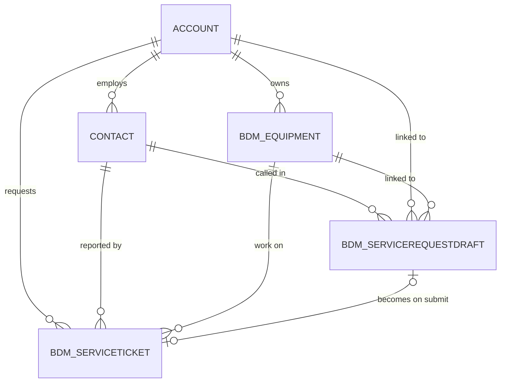
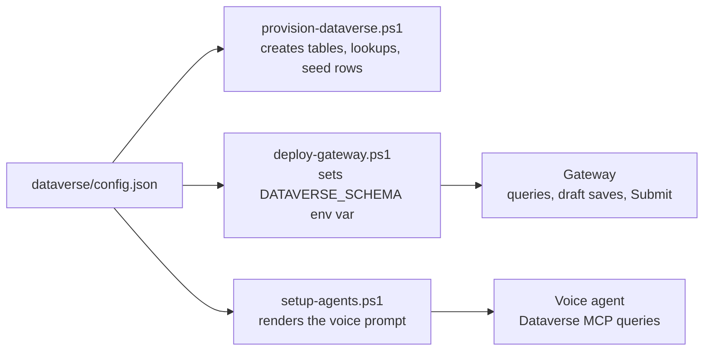

# 18 · Table configuration

**One file decides which Dataverse tables the whole solution uses: [`dataverse/config.json`](../dataverse/config.json).**
The provisioner, the gateway and the voice agent all read it, so a table change is made once and carried everywhere.
Nothing about customer, contact, equipment, ticket or draft tables is hardcoded.

## What the file looks like

```json
{
  "profile": "standard-account",
  "roles": {
    "customer":  "account",
    "contact":   "contact",
    "equipment": "bdm_equipment",
    "ticket":    "bdm_serviceticket",
    "draft":     "bdm_servicerequestdraft"
  },
  "describe": { "account": { "table": "Customers ...", "name": "Company name" } },
  "ticketDescriptionMax": 4000
}
```

| Key | Meaning |
|---|---|
| `roles` | Which Dataverse table plays each role. Values are logical table names. `contact` is optional: omit it and the solution matches callers on the account phone only. |
| `describe` | Plain-language table and column meanings. They are rendered into the voice agent prompt so the agent queries the right tables. |
| `ticketDescriptionMax` | Description length limit; derived from the org when omitted. |
| `profile` | A label only. |
| Anything else | Optional explicit overrides (`names`, `columns`, `options`, ...). Anything written here wins over what is derived. See [04](04-configuration.md). |

Columns, lookups, phone columns and priority option values are **not** listed. They are discovered from the org's
metadata, so a typical customer edits only `roles`.

## Default data model



| Role | Default table | Kind | Why |
|---|---|---|---|
| customer | `account` | standard | The company. Equipment and tickets belong to it. |
| contact | `contact` | standard, optional | The person who calls. Belongs to an account. |
| equipment | `bdm_equipment` | custom | Assets owned by an account. |
| ticket | `bdm_serviceticket` | custom (or `incident`) | Created only by a rep's Submit. |
| draft | `bdm_servicerequestdraft` | custom | Live draft built during the call. |

Details and columns: [05](05-data-model.md).

## Who reads the file



| Consumer | How it uses the config | When it picks up a change |
|---|---|---|
| **Provisioner** | Creates only what the roles need: standard tables as-is, custom tables and lookups where needed. Idempotent. | On the next run. |
| **Gateway** | Receives the JSON as the `DATAVERSE_SCHEMA` env var (base64). It reads the org metadata at first use and maps its internal canonical names to the real table, column and lookup names. | On the next deploy or revision restart. No image rebuild. |
| **Voice agent** | `setup-agents.ps1` fills the prompt placeholders (table names, phone columns, contact step, schema notes) from the config. The prompt carries a `dataverse-config: <hash>` comment so you can tell which config an agent version was built from. | When agents are republished. |
| **Note-taker** | Writes through the gateway, so it follows the gateway's config. | With the gateway. |

The gateway and the voice agent are configured separately, so **a table change needs both to be updated**. If they
disagree, the agent queries one set of tables while the gateway saves to another.

## Caller matching

1. The caller's number is matched against **contact** phones (`mobilephone`, then `telephone1`-`telephone3`).
2. A unique contact match resolves to its **account**; the contact is stored on the draft as the caller.
3. Otherwise the account's own phones (`telephone1`-`telephone3`) are tried.
4. No match: the agent asks for name and company and never invents a customer.

The voice agent may state a matched person's name only as a confirming question ("Am I speaking with ... from ...?").
Numbers are compared on their last digits, so any stored format works (`(405) 602-9804`, `+1 405 602 9804`, `4056029804`).

## Changing the tables

1. Edit `roles` in `dataverse/config.json` (for example `"ticket": "incident"` to use Cases).
2. Run `dataverse\provision-dataverse.ps1 -OrgUrl <org>` to create what the roles need. Use `-SeedDemoData` for sample rows.
3. Validate: `cd src\intake-gateway; python -m app.preflight` with `DATAVERSE_SCHEMA_FILE=..\..\dataverse\config.json` and `DATAVERSE_URL` set. It reports missing tables, columns and lookups.
4. Deploy the gateway: `infra\deploy-gateway.ps1 -ParametersFile <params>`. A previously built image is fine; the config is not baked into it.
5. Republish the agents: `foundry\setup-agents.ps1 -ParamsFile <params>`.

## Local runs and tests

Set `DATAVERSE_SCHEMA_FILE=dataverse\config.json` for local gateway runs, preflight and tests. The same file is used
everywhere; there are no per-profile config files.

## Rules of thumb

- Keep account (and contact) phone numbers filled in. They drive caller matching.
- Equipment belongs to the account, not to a person.
- A table named in `roles` must exist in the org. Otherwise the gateway cannot read its metadata (`not found`) and preflight names what is missing, so run preflight before deploying.
- The gateway identity needs a Dataverse application user. `deploy-gateway.ps1` creates it, so a 403 on `/v1` means that step failed or was skipped.
- The params file's `dataverseSchema` overrides the file. Leave it empty unless you mean to.
