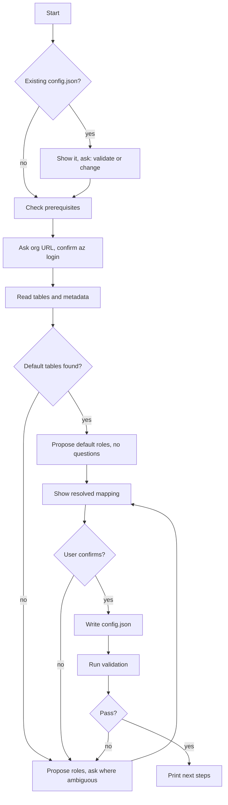

# 20 · Design: Dataverse config agent

Status: **proposed, not built.** This is the design for a custom Copilot CLI agent, with a skill, that helps a customer
create `dataverse\config.json` by connecting to their own Dataverse org. Read
[18 · Table configuration](18-table-configuration.md) first; it defines the file this agent produces.

## Problem

`dataverse\config.json` names the tables the gateway, the provisioner and the voice agent use. Writing it by hand means
knowing each table's logical name, which columns hold the phone, name and status, and which lookup links a Contact to its
Account. Customers with their own tables get this wrong, and some cases are only found by trial and error:

- `incident.customerid` is one polymorphic column shared by Account and Contact, so there is no separate contact lookup.
- `contact` has two lookups to Account (`parentcustomerid` and `msa_managingpartnerid`); only `parentcustomerid` is right.

An interactive agent can inspect the org, propose a mapping, ask where it is ambiguous, and validate the result.

## Goals

- A customer ends with a **validated** `dataverse\config.json` and the exact next commands, without hand-editing JSON.
- Zero-question path for the shipped default (standard Account/Contact plus the custom `bdm_` tables).
- Every mapping is shown to the user and confirmed before the file is written.
- The repo's own code decides the final mapping and validity.

## Non-goals

- Creating or changing Dataverse tables or data (stays in `provision-dataverse.ps1` and `seed-demo-data.ps1`).
- Deploying the gateway or publishing agents (`deploy-gateway.ps1`, `setup-agents.ps1`).
- Replacing `discover.py` or reimplementing its resolution logic.
- Handling secrets other than the user's existing `az` login.

## Users and entry points

| User | Starts with | Wants |
|---|---|---|
| New customer, default tables | An empty org or the standard tables | Defaults, no questions |
| Customer with existing tables | An org with their own Account/Case/asset tables | A mapping to those tables |
| Developer | An existing `config.json` | Check or update it after a table change |

The agent lives in the repo (for example `.github\agents\` or the CLI's custom-agent location) with a skill folder next to
it, so it ships with the docs and scripts.

## Workflow

1. **Prerequisites.** Check `az` is installed and logged in, Python 3.11+ with the gateway venv (or `httpx`) is available.
   If something is missing, say what and how to fix it. Offer the PowerShell fallback below.
2. **Org.** Ask for the org URL (`https://<org>.crm.dynamics.com`) and get a token with
   `az account get-access-token --resource <org>`. Never ask for a password or secret.
3. **Discover.** Read-only metadata calls (see Snippets). Filter tables by name hints and ask the user which tables to look
   at; never dump hundreds of tables.
4. **Propose roles.** One table per role:

   | Role | Required | Expected shape |
   |---|---|---|
   | `customer` | yes | Company; has a name and one or more phone columns |
   | `contact` | no | Person; has a name, phone columns and a lookup to the customer |
   | `equipment` | yes | Asset owned by a customer; has an asset number |
   | `ticket` | yes | Service ticket or Case; has a title, description and priority |
   | `draft` | yes | The rep-review table; usually `bdm_servicerequestdraft` |

5. **Confirm columns.** For each role show the resolved column for each canonical field (name, phone, status, priority and
   so on). Ask only where the agent cannot choose with confidence (see Ambiguity rules).
6. **Write** `dataverse\config.json` with `roles`, `describe` (one-line descriptions the voice agent reads) and
   `ticketDescriptionMax`. Show the diff against the previous file.
7. **Validate** (see Validation). Loop back to step 4 on failure.
8. **Next steps.** Print the ordered commands: `provision-dataverse.ps1` (only if tables are missing), `init-gateway-params.ps1`,
   `setup-agents.ps1`, `deploy-gateway.ps1`. Remind the user that a table change needs both a gateway redeploy and an agent
   republish.

## Ambiguity rules

The agent must **ask**, not guess, in these cases:

| Situation | Question |
|---|---|
| Several tables fit a role | Which table is the customer / ticket / equipment table? |
| Several phone columns | Which of these hold caller numbers? (Show populated counts, not values.) |
| Several lookups to the customer table | Which one is the contact's company? Prefer `parentcustomerid`, but confirm. |
| Polymorphic lookup shared with the customer (for example `incident.customerid`) | Explain that no separate contact link exists, and confirm the contact is matched by phone only. |
| Priority option set values differ from Low/Normal/High/Urgent | Which value is which? |
| No equipment table | Create one with the provisioner, or run without equipment? |

It may decide silently only when exactly one candidate fits and the name matches the canonical field.

## Snippets (the skill's `scripts\`)

Thin, read-only, tested against a real org before shipping. Each snippet prints JSON for the agent to read.

| Script | Call | Purpose |
|---|---|---|
| `token` | `az account get-access-token --resource <org>` | Auth, no secret handling |
| `list_tables` | `GET EntityDefinitions?$select=LogicalName,DisplayName,EntitySetName,PrimaryIdAttribute,PrimaryNameAttribute&$filter=...` | Candidate tables |
| `inspect_table` | `GET EntityDefinitions(LogicalName='x')?$expand=Attributes($select=LogicalName,AttributeType,RequiredLevel),ManyToOneRelationships($select=ReferencingAttribute,ReferencedEntity,ReferencingEntityNavigationPropertyName)` | Columns and lookups; exposes polymorphic and multiple lookups |
| `option_sets` | Priority and status picklists | Map priority values |
| `field_counts` | `GET <set>?$select=<col>&$top=50` | How many rows have each phone/name column populated |

Rules:

- **GET only.** No POST, PATCH or DELETE anywhere in the skill. State this in `SKILL.md`.
- Where the repo is present, prefer `app.discover.fetch_meta` and `discover.resolve` over the raw calls, so resolution
  cannot drift from the gateway.
- PowerShell fallback (`Invoke-RestMethod`) for machines without Python.
- Handle paging (`@odata.nextLink`), 401 (re-login hint) and 403 (identity lacks read access) with clear messages.

## Validation

The agent never declares success on its own judgment. It runs the repo's tools and reports their output:

1. `DATAVERSE_SCHEMA_FILE=dataverse\config.json` then `python -m app.preflight` in `src\intake-gateway`. Success means
   "config parsed", "Dataverse reachable" and no "Dataverse schema" failure. Unrelated environment failures (missing
   `PUBLIC_BASE_URL`, `API_KEYS` and similar) are expected before deployment; the agent explains that.
2. `dataverse\get-config.ps1` prints the resolved tables and the `contactsEnabled` / `equipmentEnabled` flags. Show these to
   the user as the final confirmation.
3. Optional: `python -m pytest -q` is not needed for customers.

## Safety and privacy

- **Read-only** against Dataverse; the only file it writes is `dataverse\config.json` (plus a `.bak` of the previous one).
- **Sampling is opt-in.** Before reading any rows, say that real customer data will be read. Show populated counts and
  field names; if values are shown, mask them (`405-***-9804`).
- **No secrets** in the file or the conversation. Authentication is the user's `az` session only.
- **No writes to the cloud.** Table creation and seeding are run by the user, never by the agent.
- **Confirm before overwrite.** Show the diff and wait for approval.

## Agent definition (outline)

- **Name:** `dataverse-config`.
- **Description:** Helps create and validate `dataverse\config.json` for FloorWorks live intake.
- **Tools:** shell (read-only commands), file read, file write limited to `dataverse\config.json`.
- **Instructions:** the workflow, ambiguity rules, safety rules and the "ask one question at a time, with choices" style.
- **Skill folder:** `SKILL.md` (workflow and rules), `scripts\` (snippets), `reference\config-keys.md` (a short copy or link
  to doc 18).

## Testing

| Test | How |
|---|---|
| Default org | Run against an org with the shipped tables; expect no questions, a config identical to the committed one |
| Custom tables | Run against a fixture org; expect questions for roles and phone columns |
| Polymorphic Case lookup | Fixture where `customerid` is shared; agent explains and omits the contact lookup |
| Two Account lookups on Contact | Agent prefers `parentcustomerid` and asks to confirm |
| Missing access | 403 produces the "identity lacks read access" message |
| Read-only guarantee | A check that no snippet issues a non-GET request |
| Snippets | Each runs against a real org; outputs match fixtures in `src\intake-gateway\tests\fixtures\` |

Reuse the fixtures (`cdm.json`, `floorworks.json`) from the gateway tests, so the agent and `discover.py` are checked against
the same metadata.

## Open questions

1. Where should the agent live: in this repo (`.github\agents\`), or in a shared plugin so other projects can use it?
2. Should it also offer to run `provision-dataverse.ps1` after the config is written, with confirmation, or only print the command?
3. Minimum Dataverse privileges for the reading user: is System Customizer enough for metadata reads?
4. Should the agent support several configs (one per environment), or only the single `dataverse\config.json`?
5. Should `describe` text be generated by the agent from the table metadata, or kept as the repo's defaults unless the user edits them?

## Build plan

1. Write and test the snippets against a real org and the fixtures.
2. Write `SKILL.md`, then the agent definition.
3. Run the test table above; fix gaps.
4. Link from docs 17 and 18, and add a one-line mention in `README.md`.
